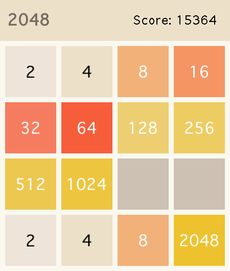

# sfml-2048

> A classic 2048 clone built with modern C++ - designed from the ground up for testability, cross-platform CI, and clean architecture.

[](https://github.com/EnesGoker/sfml-2048/actions/workflows/ci.yml)
[](https://github.com/EnesGoker/sfml-2048/actions/workflows/release.yml)
[](LICENSE)
[](https://en.cppreference.com/w/cpp/20)
[](https://www.sfml-dev.org/)

<p align="center">
  
</p>

---

## What is this?

This is not just a 2048 clone. It's a **portfolio-grade C++ project** that demonstrates:

- A game core that is **decoupled from SFML** and **unit-testable**
- A **multi-platform CI pipeline** (Ubuntu, macOS, Windows)
- **Deterministic core logic** with reproducible tests
- Automated versioning + release artifacts

If you're here to play the game, great. If you're here to understand how it's built, read on.

---

## Quick Start (Build & Run)

### Prerequisites

- **CMake 3.24+**
- **vcpkg** (manifest mode) and `VCPKG_ROOT` set
- A **C++20** compiler (GCC 11+, Clang 13+, MSVC 2022+)

Keep `VCPKG_ROOT` set during configure, build and test when using vcpkg presets.

> Tip: If you don't have vcpkg yet, install it once:
> - macOS/Linux: `git clone https://github.com/microsoft/vcpkg.git && ./vcpkg/bootstrap-vcpkg.sh`
> - Windows: `git clone https://github.com/microsoft/vcpkg.git && .\\vcpkg\\bootstrap-vcpkg.bat`

### macOS

```bash
cmake --preset vcpkg-debug
cmake --build --preset build-vcpkg-debug
open build/vcpkg-debug/sfml_2048.app
```

The macOS build includes assets in `Contents/Resources/assets`. For command-line diagnostics:

```bash
./build/vcpkg-debug/sfml_2048.app/Contents/MacOS/sfml_2048 --help
```

### Linux

```bash
cmake --preset vcpkg-debug
cmake --build --preset build-vcpkg-debug
./build/vcpkg-debug/sfml_2048
```

### Windows

```bat
cmake --preset vcpkg-debug -G "Visual Studio 17 2022" -A x64
cmake --build --preset build-vcpkg-debug --config Debug
build\vcpkg-debug\Debug\sfml_2048.exe
```

### Backend and unit tests without the desktop application

For a Debug build with vcpkg, run the matching configure, build and unit-test presets:

```bash
cmake --preset vcpkg-headless-debug
cmake --build --preset build-vcpkg-headless-debug
ctest --preset test-vcpkg-headless-debug
```

For installed system dependencies or pinned FetchContent fallbacks:

```bash
cmake --preset headless-debug
cmake --build --preset build-headless-debug
ctest --preset test-headless-debug
```

Release uses `vcpkg-headless-release` or `headless-release`, with the same `build-` and `test-`
prefixes. Each configure preset owns its matching `build/<preset-name>` directory. All four
headless presets select application `OFF` and tests `ON`; their test presets run the exact
`unit` label, display failures and fail if no tests are registered. Preset schema 5 matches
the CMake 3.24 minimum. Native macOS workflow and minimum-version validation are recorded in
[the testing strategy](docs/testing.md#step-64-preset-validation).

`SFML_2048_BUILD_APP` and `BUILD_TESTING` both default to `ON`. Disabling the application
removes SFML/fmt/OpenAL discovery, the desktop executable, asset synchronization, Runtime
installation, packaging and platform acceptance. Backend libraries and the complete unit suite
remain available. [Manual commands](docs/testing.md#manual-headless-commands) also cover a
backend-only build with tests disabled.

CMake selects vcpkg dependencies before toolchain installation: JSON is common, SFML/fmt belong
to the application, and Catch2 belongs to tests. The two build options manage manifest features;
raw vcpkg feature arguments and installer response files are rejected. Standalone vcpkg
installation defaults to both desktop and test features. Initial acquisition may need network access.
All four option combinations passed fresh native macOS vcpkg Debug/Release regression,
including independent headless audits, component-install boundaries, desktop installed/ZIP
runtime acceptance and a separate isolated graphical smoke fixture;
[step 6.7 records the evidence and remaining platform scope](docs/testing.md#step-67-final-build-and-package-regression).
Dedicated headless presets are implemented in step 6.4. Step 6.5 adds a fresh-build dependency audit:

```bash
python3 scripts/verify_headless.py --source . --output build/headless-acceptance --config Debug
```

The verifier retains commands, header/link/symbol evidence and a JSON report in a new run
directory. Its Python requirement belongs to the acceptance tool; headless CMake does not
discover Python. See [headless dependency acceptance](docs/testing.md#headless-dependency-acceptance-step-65)
for Release, backend-only and vcpkg commands and the supported native tools. Step 6.6 adds
separate headless Debug/Release CI jobs for Linux, macOS and Windows, guarded configuration
checks on every job, and fresh full dependency audits on Linux/macOS Release. Native macOS
validation and the final phase 6 build/package regression have passed; the new hosted jobs
have not yet run. See the
[build contract](docs/build-contract.md) for all four combinations and pinned versions.

### Graphical UI acceptance

In a native graphical session with Python 3 available:

```bash
cmake --preset ui-acceptance-release
cmake --build --preset build-ui-acceptance-release
ctest --preset test-ui-acceptance-release
```

For vcpkg use `vcpkg-ui-acceptance-release`, `build-vcpkg-ui-acceptance-release` and
`test-vcpkg-ui-acceptance-release`, keeping `VCPKG_ROOT` set. Graphical acceptance is
opt-in; ordinary desktop and headless presets leave it OFF. Reports and 1×/2× images
are stored in the configured build directory. Native pointer/VoiceOver scope is
recorded separately in [the testing strategy](docs/testing.md#maintained-graphical-acceptance-step-1062).

---

## CLI Options

Run `--help` to see the up-to-date list from the binary.

| Flag | Description |
|---|---|
| `--fps <uint>` | Frame-rate cap |
| `--vsync` | Enable vertical sync |
| `--no-vsync` | Disable vertical sync |
| `--check-runtime` | Report native paths and packaged resource readability as JSON; opens no window or user profile |
| `--help` | Show usage |

`--check-runtime` exits with `0` on success or `1` on a path/resource failure. It reads
the packaged font and sound bytes without loading or changing scores/settings. It does not
test SFML decoding, rendering, sound playback or save permissions.

---

## How to Play

| Input | Action |
| --- | --- |
| Arrow keys | Move tiles during play |
| Tab / Shift+Tab | Change control focus |
| Enter / Space on a focused action | Activate on key release |
| Enter while editing the player name | Validate the name and start |
| N / unfocused Enter during play | Start a new round |
| Esc during play | Return to the main menu |
| Esc on Win | Continue the current round |
| N / unfocused Enter on Game Over | Replay |
| Esc on Game Over | Return to the main menu |
| Window close control | Exit |

On macOS, VoiceOver exposes the required player-name field, named actions, Sound
state, complete scores, leaderboard and live board values. The board provides four
directional accessibility actions; outcome dialogs expose their active actions.
Local VoiceOver operation has passed; platform scope and validation evidence are
recorded in [the UI quality audit](docs/ui-quality-audit.md).

---

## Architecture

Scores and sound preferences are stored in the user's profile directory, independently of the
launch folder: Application Support on macOS, LocalAppData on Windows, and XDG data home on
Linux. At startup, supported `scores.json` and `settings.json` files from the captured launch
folder are copied into missing profile files. Existing profile files always take precedence;
the original launch-folder files remain intact. An unresolved import protects that file from
writes while the game continues with memory-only changes for the current process.
Path and persistence details: [docs/architecture.md](docs/architecture.md).

Fonts and sounds use one read-only asset root: macOS application bundle resources, or `assets`
beside the executable for Windows/Linux and plain macOS builds. Runtime loading does not search
the working directory or source tree. Build and runtime installation use the same layout.

The project is split into two clear layers:

```text
src/
├── core/     # Pure game logic (no SFML). Fully testable.
└── app/      # Platform/persistence services and SFML rendering/input
```

The core layer operates on plain data structures and can be exercised by unit tests without a display.
The app layer owns rendering and delegates gameplay state changes back to core. Its path,
session, score-coordination and settings services are also testable without an SFML window.
`game_core` and the shared `app_logic` session/coordinator library are explicit static targets;
desktop graphics and audio dependencies belong only to the optional application target.

This separation means:
- You can swap the renderer without touching game logic
- Gameplay and persistence tests run without a display
- Rules are easier to reason about in isolation

Full details: [docs/architecture.md](docs/architecture.md)

---

## Testing

Catch2 unit tests run via CTest with `BUILD_TESTING=ON`, including headless builds. Native
platform acceptance is included when the desktop application is also enabled.
Platform acceptance requires Python 3; it checks the actual executable and uses a separate
guarded worker for persistence in temporary profiles:

```bash
ctest --test-dir build/vcpkg-debug --output-on-failure
```

CI defines separate headless and desktop jobs across platforms. Linux sanitizer and coverage
jobs configure the headless unit suite, while desktop jobs retain native runtime acceptance.
Coverage gate: CI enforces `>=80%` line coverage on Linux.
Full strategy: [docs/testing.md](docs/testing.md). Repeatable runtime checks and platform evidence:
[docs/platform-acceptance.md](docs/platform-acceptance.md).
Score persistence acceptance: [docs/score-persistence-acceptance.md](docs/score-persistence-acceptance.md)

---

## CI / CD

Every pull request goes through quality gates:

1. `clang-format` check
2. Static analysis
3. Separate desktop builds and headless Debug/Release builds (Ubuntu, macOS, Windows)
4. Unit tests + sanitizers (ASan/UBSan on Linux)
5. Coverage report

Headless jobs check CMake dependency-provider evidence and the installed vcpkg ports before
building. Linux/macOS Release also audit fresh test-enabled and backend-only builds, including
compiler headers, archive symbols and native runtime dependencies where applicable. Evidence
uploads run even after a failure. The full audit does not support Windows/MSVC; Windows uses
the portable configuration check and the complete unit suite. Local implementation validation
and remaining hosted-run evidence are recorded in [the testing strategy](docs/testing.md#step-66-ci-validation).

Releasing:
- Pushing a `vX.Y.Z` tag triggers an automated release
- Release artifacts are produced for all three platforms

---

## Tech Stack

| | |
|---|---|
| Language | C++20 |
| Graphics / Input | SFML 2.6.2 |
| Build | CMake + CMake Presets |
| Dependencies | vcpkg (manifest mode) |
| Testing | Catch2 + CTest |
| CI/CD | GitHub Actions |

---

## Documentation

- [Architecture](docs/architecture.md)
- [Build Configuration Contract](docs/build-contract.md)
- [Testing Strategy](docs/testing.md)
- [Score Persistence Acceptance](docs/score-persistence-acceptance.md)
- [Maintenance Playbook](docs/maintenance.md)
- [Changelog](CHANGELOG.md)
- [Contributing](CONTRIBUTING.md)
- [Security Policy](SECURITY.md)
- [Third-Party Notices](THIRD_PARTY_NOTICES.md)

---

## License

MIT - see [LICENSE](LICENSE) for details.
