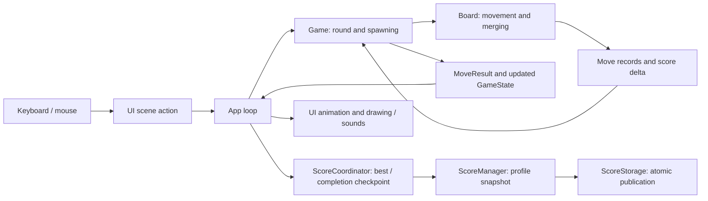

# Architecture

The project keeps the 2048 rules independent of SFML. Each class has a small, explicit job so a
reader can find a rule, screen, or state change without searching the entire application.

## Core: tiles, board, and a game round

- `src/core/Tile.hpp`: a tile's value and whether two non-empty tiles can merge. Tiles have no
  drawing or animation behavior.
- `src/core/Board.hpp` / `Board.cpp`: the `4x4` grid, directional sliding and merging, empty cells,
  tile placement, and whether any move is available. A board does not own a running score,
  randomness, or an application screen.
- `src/core/GameState.hpp`: the round's score and independent `won` / `gameOver` flags.
- `src/core/Game.hpp` / `Game.cpp`: a round of play. `Game` resets its board, chooses random spawn
  positions and values, applies board moves, and updates the score and round flags.
- `src/core/ScoreManager.hpp` / `ScoreManager.cpp`: independent best score and completed-round
  history, including round identities, player names, and timestamps. The top five is derived from
  that history; the current round's score remains owned by `Game`.
- `src/core/FileStorage.*`: model-independent atomic file publication, native byte snapshots and
  byte-exact legacy-format backup. `ScoreStorage.*` retains the score compatibility API.

`Game::Grid` and the existing `Game` methods remain available: `reset()`, `reset(seed)`,
`loadState(grid, score)`, `applyMove(direction, spawnOnMove)`, `getGrid()`, `getScore()`, and
`isGameOver()`. `hasWon()` exposes the same achievement flag as `getState().won`. Seeded games
remain deterministic; `loadState` replaces the board and score, derives fresh flags from that
board, and leaves the random generator's sequence intact. It does not carry a previous round's
achievement into a newly loaded board.

The winning threshold is `Game::kWinningTileValue` (`2048`); larger values also qualify when
loading a board. `won` is latched for the duration of a round: state updates OR in the target
check, so merging a `2048` into `4096` never clears achievement. `gameOver` is recomputed from
available moves independently. All four flag combinations are valid, including a won round
with no remaining moves. Reset clears both flags before spawning the initial two tiles.

Winning does not block `Game::applyMove`. A future Continue action only dismisses a UI overlay;
there is no pause, Continue command, or overlay state in the core.

Normal spawning chooses an empty post-move cell and generates only `2` or `4` (90% / 10%).
Placement must succeed before `Game` reports a `SpawnedTile`. A changed turn with spawning
enabled adds exactly one tile; no-op and spawn-disabled turns leave the random sequence intact.
`Board::placeTile` never replaces an occupied cell, while accepting larger tile values needed
for general board construction. `Game` updates its status after spawning: a full board is
terminal only when no orthogonal merge remains. Reset clears the board and round state before
placing two new normal tiles.

## Move results are the shared source for animations

`Board::applyMove` returns whether the board moved, the gained score, tile movement records, and
merge records. `Game::applyMove` adds the spawned tile when a move succeeds. A movement record
contains the tile value, source cell, destination cell, and whether it participates in a merge.
A merge record contains the destination cell and resulting value.

These records describe what happened, without SFML types or animation timing. The UI uses them
to animate the board instead of recomputing the slide and merge rules. Both tiles in a merge
have movement records, even when one is already at its destination. A no-op produces no
movement records, no gained score, and no new tile.

## Application and UI

- `src/app/main.cpp`: command-line options and the call to `app::run`.
- `src/app/App.cpp`: window/resource setup and the application loop. It dispatches input to the
  current scene, applies scene actions, calls the game, plays sounds, and draws the active screen.
- `src/app/GameSession.hpp`: player name, round identity, and whether the current round's final
  score has already been recorded, together with the owned `Game`.
- `src/app/ScoreCoordinator.*`: SFML-independent score checkpoints for a session, completion
  acknowledgement, controlled persistence retries, and one-time notification results.
- `src/app/ui`: shared SFML drawing helpers, scene action types, and individual splash,
  leaderboard, playing, and game-over screens.
- `src/app/AssetLocations.*`: native executable/bundle asset-root discovery.
- `src/app/AssetResolver.*`: one-root resource validation and native-path binary reads.
- `src/app/SoundManager.*`: decoding and playback, consuming an asset snapshot and settings store.

The playing screen converts input into a scene action, including an optional move direction.
The application applies that direction to the game and passes the result to the screen's
`onMove` method. The screen owns animation timing and drawing; it does not modify the session
or play sounds.

The round's achievement/terminal flags and the visible UI scene are separate state. A game can
be over while the last move is still animating. Its final score is recorded immediately after
the logical terminal move; only the game-over screen waits for animations to finish.

## Score memory model (step 4.1)

`ScoreManager::updateBestScore` monotonically advances best without creating a completed game.
`recordCompletedGame` accepts a nonempty round ID and a nonnegative score, checks for that ID
before any mutation, appends once, then advances best if necessary. Replaying the same ID with
different metadata or a higher score is still a no-op. Distinct IDs may have identical scores.
The caller is responsible for submitting only logically completed rounds.

`completedGames()` exposes history in insertion order. `topScores()` returns a sorted snapshot
of at most five entries, ordered by score descending, then timestamp descending, with stable
insertion order for equal keys. Reading or modifying that snapshot cannot mutate history.
`isDirty()` reports an unsaved in-memory change; successful saving clears it, while a failed
save retains it. Round acknowledgement belongs to `GameSession`, independently of disk success,
so retrying persistence does not append another completed game.

`GameSession` creates a new opaque ID on construction and reset. Moves, terminal no-ops,
player-name changes, and completion acknowledgement retain the ID. A random process nonce and
monotonic counter generate IDs without consuming `Game`'s RNG. Sessions cannot be copied or
moved, preventing two mutable owners of an ID. Seeded construction/reset preserve gameplay
determinism. Winning/Continue does not create a new round, and early acknowledgement is ignored.

## Versioned score profiles and migration preparation (step 4.2)

The canonical version-2 profile stores best independently from completed games:

```json
{
  "version": 2,
  "best_score": 50000,
  "completed_games": [
    {
      "game_id": "round-identity",
      "score": 18432,
      "played_at": "2026-10-06T09:00:00Z",
      "player_name": "Oyuncu"
    }
  ]
}
```

All shown fields are required. Scores must be integer values between zero and `INT_MAX`;
floating-point, boolean, negative, and overflowing values are rejected. `best_score` must be
at least the maximum completed score, but may be larger with an empty or lower-scoring history.
Completed IDs are nonempty strings and must be unique within the file. Player names are
nonempty strings. Timestamps are strings retained verbatim, without date normalization.
Unknown v2 fields are rejected to avoid silently discarding data on a subsequent save.

The parser requires the entire input to be valid JSON and rejects repeated keys in every object,
including escaped spellings of the same key. It distinguishes unsupported integer versions from
invalid field types. Duplicate completed IDs, invalid entries, and inconsistent best/history
reject the entire document; invalid records are never skipped to create a partial profile.
Literal NUL bytes are rejected before JSON parsing, so a valid prefix cannot conceal an ignored
suffix. Escaped `\u0000` inside JSON strings remains valid metadata.

Loading validates into a temporary model before replacing memory. On failure, previous
best/history/dirty/migration flags remain intact and writing is blocked. `lastLoadStatus()` reports
`NotLoaded`, `Missing`, `LoadedV2`, `LegacyMigrationPending`, `InvalidData`,
`UnsupportedVersion`, or `IoError`. A missing file produces a clean default profile; a valid
v2 profile is clean. Existing files require successful loading before writing is permitted.
The status describes the last load attempt, not a later save.

An unversioned root with only `scores` is treated as legacy. All entries are validated first,
their original order, scores, timestamps, and player names are retained, and best becomes the
maximum score. Missing or empty legacy names use `Oyuncu`. Historical entry extras such as
`seed` are accepted but are not part of the new model. Entries receive deterministic IDs
`legacy-1`, `legacy-2`, etc. from source positions, so identical historical payloads remain
separate completed games. There is no top-five truncation during migration.

Legacy loading sets `needsMigration()` and dirty to true and never writes to disk. No backup is
created by reading. A subsequent successful save publishes v2 only after preserving the exact
original bytes in a `.bak` file. The repository's existing `scores.json` is left untouched by
implementation and tests; tests use temporary directories.

New files, loaded v2 profiles, and migrated profiles serialize independent best and round IDs,
including deduplication after reopening. Serialization finishes before storage work begins;
serialization errors therefore preserve source bytes, dirty and migration flags.

## Atomic score storage and retry (step 4.3)

`ScoreManager` keeps the exact binary bytes from its last successful load/save. This snapshot
preserves CRLF and Unicode source bytes for backup and detects stale data. The native storage
backend compares the current source with those expected bytes before writing and immediately
before publication. A previously missing source is expected to remain absent. Non-regular files
and symlinks are rejected. Source changes require a reload instead of overwriting another file.

The storage pipeline creates a unique temporary file in the destination directory using
exclusive creation. It fully writes serialized v2 bytes, syncs the file and checks close before
publishing it. Native write loops handle partial writes and interrupted POSIX writes. An existing
temporary file is never reused or removed; cleanup applies only to files owned by this attempt.
The old destination is never deleted first. Same-directory publication uses POSIX rename or
Windows `MoveFileExW` with replacement/write-through flags and without cross-volume copy.

For migration, the `.bak` is also fully written, synced and closed before publication without
overwrite. An existing byte-identical backup can be reused during retry; a different backup is
a conflict and remains untouched. A backup already published before a failed final commit stays
available for the next attempt. Later v2 saves do not rewrite the migration backup.

`lastSaveStatus()` reports `NotSaved`, `Saved`, `WriteBlocked`, `SerializationError`,
`SourceChanged`, `BackupConflict` or `IoError`. Only confirmed publication updates the source
snapshot and clears dirty/migration flags. Ordinary I/O failures retain the same memory snapshot
and permit retry; a source conflict blocks writing until a successful reload. Retrying `save()`
never records another completed game. No retries are scheduled per frame in this layer.

The internal file-operation seam permits deterministic partial-write, sync, close, backup and
replacement failures while exercising the actual storage pipeline. It is separate from score
rules and SFML. The contract provides atomic visibility and file sync on supported local file
systems; it does not promise survival of every power-loss scenario. Snapshot checks are stale
source protection, not concurrent-writer compare-and-swap or cross-process locking.

## Application score checkpoints (step 4.4)

`ScoreCoordinator::checkpoint` first advances best from the current round's score. If the round
is logically over and has not been acknowledged, it appends that round once and acknowledges
it in memory before any disk operation. It then saves one combined snapshot when dirty or
migration is pending. A failed save leaves best/history available in memory; subsequent
checkpoints retry that profile without appending another completion or changing its metadata.

The app checkpoints after every changed move, at startup, and before restart, starting a new
round, returning to the splash/leaderboard, or closing/quitting. Startup completes a validated
legacy migration with the storage layer's exact backup. Starting a new round checkpoints the
old session before changing its player name or identity. Early restart/menu exit/close saves
an ongoing best but does not manufacture a completed game. Winning alone is not a completion;
continued moves keep the same round until logical game-over.

Idle frames and no-op moves do not checkpoint or write. Clean checkpoints also skip saving.
Failed writes retry at the next meaningful checkpoint, rather than every rendered frame.
Close/quit processes its final checkpoint and stops polling events, so queued input cannot
mutate a closed session. There is no promise of recovery from a forced process termination
or from a disk failure that still exists at the final close attempt.

The displayed best reads directly from `ScoreManager`. The coordinator returns a first-best
notification once per round and a completion notification once per session acknowledgement;
the app plays their sounds independently of save success. Repeated identical save failures
produce one diagnostic until recovery or a different failure. A source-change failure keeps
its original diagnostic when later writes are blocked. These results contain no SFML types
or UI commands, and animation timing cannot control history recording.

## Runtime data flow



Core tests exercise the rules and round state without opening an SFML window. The UI remains
responsible for colors, text, controls, rendering, and animation durations.

## Persistence acceptance and platform boundary (step 4.5)

The memory, schema, storage and application checkpoint contracts have completed the acceptance
pass described in [score-persistence-acceptance.md](score-persistence-acceptance.md). Real seeded
rounds exercise winning, continued play, completion, restart, reopen, full history and top-five
ranking without adding production state-injection hooks. A temporary macOS fixture exercises
the SFML application loop at the terminal animation boundary and under native write failures.

At the end of step 4.5, the app still resolved `scores.json` from the working directory. Step
5.2 replaces that profile path with a platform-owned per-user directory; installed Windows/macOS
package validation remains a separate step. The storage backend
already contains Windows and POSIX implementations, with native execution verified on macOS
in this acceptance pass.

## Application path contract (step 5.1)

`app_paths` is a C++20 library with no SFML, JSON or native platform dependency. Its
`resolveAppPaths(PathContext, PathOptions)` function separates the profile data directory from
the application asset root. `AppPaths` exposes `userDataDir()`, `assetDir()`, `scoresFile()` and
`settingsFile()`, along with the selected sources. `executableDir()` is present only when the
executable-relative asset layout was selected. No unvalidated, unused context is exposed.

`PathContext` is an injected snapshot, not an environment reader. Step 5.2 supplies the OS
user-data base through a native adapter; step 5.4 adds executable and bundle resource discovery.
`PathOptions` supplies explicit final-directory overrides for isolated tests.

| Location | Selection order | Required state |
| --- | --- | --- |
| User data | `userDataOverride`, otherwise `userDataBase / "sfml-2048"` | Existing directory or an absent path under an existing directory |
| Assets | `assetOverride`, otherwise `bundleResourcesDir / "assets"`, otherwise `executableDir / "assets"` | Existing directory |
| Executable directory | Used only for the executable-relative asset layout | Existing directory |

An override names the final root: `assetOverride` already points at the `assets` directory.
Consumers use paths relative to that single root, such as `fonts/Inter-Variable.ttf`; root
selection does not look for individual files. Once a source is selected, an invalid or missing
root returns an error. It never falls through to another source. Invalid, unused lower-priority
context fields cannot invalidate a successful override or bundle selection.

Selected inputs must be absolute, nonempty and free of embedded NUL characters in the native
path representation. Root directories are allowed; resolution does not certify writability.
Directory symlinks are allowed, but dangling symlinks and file ancestors are rejected. Paths
are preserved as supplied, including Unicode and spaces. Resolution does not collapse `..`
lexically, since that would change the meaning of a path containing a directory symlink.

Successful resolution returns one complete `AppPaths` value with no error. Failure returns
no partial value and a `PathError` containing its domain, reason, selected path and, when
available, the native filesystem error. Reasons distinguish absent locations, empty/relative
paths, embedded NUL, non-directory roots and I/O failures. Validation reads directory status
only; it does not create folders, test write permissions, load scores/settings, migrate files
or modify assets. Later file operations must still handle changes after this snapshot.

The resolver has no CWD, environment-variable, executable-parent or source-tree fallback.
Step 5.1 established this contract before changing runtime paths. Step 5.2 added native data
discovery, bootstrap directory creation and score/settings integration; step 5.3 adds location
migration separately from path resolution. Step 5.4 replaces the earlier asset consumer's
search candidates with this same single-root contract and aligns build/install layouts.

At step 5.1 the library was independently compilable, while the project still discovered SFML
unconditionally. Step 6.1 defined the [build configuration contract](build-contract.md);
step 6.2 implements the CMake separation described below.

## Build target boundaries (step 6.2)

`SFML_2048_BUILD_APP` and CTest's `BUILD_TESTING` are independent options, both defaulting to
`ON`. Backend libraries are always available. `game_core` is explicitly `STATIC`; the new
`app_logic` static target owns `GameSession.cpp` and `ScoreCoordinator.cpp` and exposes its
`game_core` dependency. Application and unit-test consumers link `app_logic`, compiling those
services once per build configuration. The other backend targets retain their existing native
adapters and transitive dependencies.

| Boundary | Included when | Responsibilities |
| --- | --- | --- |
| Backend libraries | Always | Rules, storage, sessions, score coordination, paths, settings, migration and runtime diagnostics |
| Desktop application | Application `ON` | SFML/fmt/OpenAL discovery, UI/input/audio, executable, assets, bundle layout, Runtime installation and CPack |
| Unit tests | Tests `ON` | Catch2 discovery/fallback, full backend test executable and CTest registration |
| Platform acceptance | Application `ON` and tests `ON` | Worker, optional Python discovery and native acceptance registration |

Headless builds do not discover SFML, fmt or OpenAL. They still require JSON and the operating
system services used by native backend adapters; test-enabled builds also require Catch2.
Missing SFML remains a configure error when the application is enabled. Headless output has
no desktop asset, Runtime-install or package target; the existing explicit `Development`
component install of `game_core` remains available.

Options also apply when reconfiguring one build directory: disabling tests replaces any old
CTest registrations with an empty index, and disabling the application clears only managed
CPack and asset-install/bundle-fixup configuration files. Existing binaries, assets and archives
remain available; clean validation still uses separate build directories.

At the step 6.2 checkpoint the vcpkg manifest still acquired desktop dependencies regardless
of these target gates. Step 6.3 adds the installer boundary below; step 6.4 adds separate
headless presets. Current direct commands are in [testing.md](testing.md).

## Dependency installation boundary (step 6.3)

`SFML_2048_BUILD_APP` and the standard `BUILD_TESTING` option are declared before the first
`project()` call. CMake derives vcpkg's manifest feature list at that point, before the toolchain
can install dependencies. JSON is common to every configuration; `desktop` owns SFML/fmt and
`tests` owns Catch2. Headless CMake configurations select no desktop feature, and configurations
without tests select no Catch2 feature.

Standalone manifest installation defaults to both features, preserving a complete desktop/test
dependency set. CMake explicitly disables manifest defaults and recomputes its managed feature
cache on each configuration. Known feature overrides are rederived from the build options;
unknown feature names, raw installer feature overrides of any option-name casing and installer
response files are configure errors. Other direct installer arguments remain available. Both
target creation and dependency acquisition use the same application/test choices, including
when reconfiguring an existing build directory. Automatic manifest installation synchronizes
the configured installed tree and may remove unused packages as the feature graph changes.
Shared download/binary caches and earlier application outputs have separate lifetimes;
dependency-absence validation uses new build/install directories.

The baseline is unchanged, SFML remains pinned at `2.6.2`, and Catch2 is pinned at `3.7.1` to
match the direct-build fallback. JSON/Catch2 package discovery and pinned FetchContent fallbacks
remain available without the vcpkg toolchain. The complete feature matrix and input policy are
in [build-contract.md](build-contract.md). Real dependency plans and fresh installation/full builds
passed for all four native macOS combinations. An actual same-directory headless test-option
round trip added and removed Catch2 while preserving the earlier test executable. Step 6.4 adds
the preset workflows below; step 6.6 adds separate headless CI jobs and portable configuration
checks. Step 6.7 revalidates the complete native macOS Debug/Release option matrix.

## Build and test workflows (step 6.4)

Schema-5 CMake presets match the CMake 3.24 minimum. Existing desktop names/directories remain
available and explicitly select application/tests `ON`. The system and vcpkg headless families
each provide Debug/Release configure, build and test presets, selecting application `OFF` and
tests `ON`. Every configure preset has its own `build/<preset-name>` directory; manual commands
use `build/manual/` so the workflows do not share caches accidentally.

The presets leave the generator, compiler and triplet to the host/caller. Configure, build and
test phases choose the matching configuration explicitly. Optional local overrides use ignored
`CMakeUserPresets.json`. vcpkg presets require `VCPKG_ROOT`
through all three phases. Headless test presets select the exact unit label, print failures and
fail when no unit tests are registered. Native macOS workflow validation passed on CMake 4.0.2;
CMake 3.24.4 additionally validated the catalog, conditions and three Ninja Multi-Config chains.
Commands and the exact validation scope are in [testing.md](testing.md).
Step 6.6 runs the vcpkg headless Debug/Release presets in a separate three-platform CI matrix;
successful hosted execution still requires evidence from those runners.

## Dependency acceptance boundary (step 6.5)

[`verify_headless.py`](../scripts/verify_headless.py) audits a fresh application-disabled build.
Its opt-in CMake dependency provider records real package/fallback requests and fails if desktop
dependencies are requested; allowed dependencies follow their normal discovery/acquisition paths.
The generated graph and raw imported-target include/link/location properties are inspected,
including links that do not appear in a static archive's generated link command. Uninspectable
scoped imports fail acceptance.

All compiled translation units must produce complete compiler header scans with system headers,
checking canonical paths as well as recorded names. All nine backend archives must remain static
and contain no SFML/fmt/OpenAL undefined symbols. Test-enabled runs execute the full unit suite
and inspect the unit executable's native dependency graph; tests-disabled runs audit libraries
and require an empty CTest index. They do not produce a final executable or prove linkage of a
separate backend consumer.

The verifier supports native GNU/Clang Makefiles/Ninja builds with macOS/Linux binary inspection;
the validation recorded for step 6.5 is native macOS arm64. Native system adapters remain valid,
and macOS system framework transitive dependencies are outside the inspected closure. The tool
retains per-stage JSON and command/header/symbol/runtime evidence without modifying preset caches
or existing dependency prefixes. Its Python dependency belongs to acceptance tooling. Commands,
negative controls and exact evidence limits are in [testing.md](testing.md#headless-dependency-acceptance-step-65).
Step 6.6 adds guarded headless CI configurations and Linux/macOS Release full audits. Step 6.7
completes renewed native macOS four-combination Debug/Release and desktop installed/ZIP runtime
acceptance. The full unit suite and all nine static backend boundaries remain intact. Phase 6
implementation is complete locally; hosted Linux/Windows and distribution checks remain
separate. Current results and limits are in
[testing.md](testing.md#step-67-final-build-and-package-regression).
The explicit headless Release installation probe produced no `Runtime` files and retained
only the optional `Development` archive `libgame_core.a`; no separate consumer linkage is
claimed. The renewed desktop graphical smoke uses a copied, instrumented application with
isolated profile roots while preserving production decoders, rendering and persistence paths.

## Native user data and settings (step 5.2)

`UserDataPaths` is the profile-only view of the same path contract. `resolveUserDataPaths`
shares validation with `resolveAppPaths` but requires no assets. `user_data_paths` adds native
base-directory discovery and explicit bootstrap, still without SFML or JSON:

| Platform | Native discovery | Application directory |
| --- | --- | --- |
| macOS | Foundation `URLForDirectory`, Application Support, user domain, `create:NO` | `~/Library/Application Support/sfml-2048/` |
| Windows | `SHGetKnownFolderPath(FOLDERID_LocalAppData, KF_FLAG_DONT_VERIFY)` | The current user's LocalAppData directory / `sfml-2048` |
| Linux | Absolute `XDG_DATA_HOME`, otherwise absolute `HOME / ".local/share"` | Selected base / `sfml-2048` |

The macOS adapter is an isolated Objective-C++ file; the rest of the application consumes
`std::filesystem::path`. Windows paths stay wide, returned COM memory is freed on every outcome,
and COM initialization is balanced only when owned by this call. A pre-existing apartment is
retained. Linux ignores empty or relative XDG values; if neither XDG nor HOME yields a valid
base, discovery reports a missing location instead of inventing a CWD or passwd fallback.
Native behavior follows [Apple's directory API](https://developer.apple.com/documentation/foundation/filemanager?language=objc),
[Microsoft's known-folder API](https://learn.microsoft.com/en-us/windows/win32/api/shlobj_core/nf-shlobj_core-shgetknownfolderpath)
and [flags](https://learn.microsoft.com/en-us/windows/win32/api/shlobj_core/ne-shlobj_core-known_folder_flag),
and the [XDG specification](https://specifications.freedesktop.org/basedir/0.8/).

`resolvePlatformUserDataPaths` accepts a discovery provider for isolated tests. A supplied
user-data override bypasses the provider entirely, including when the override is invalid.
`ensureUserDataDirectory` is the separate operation that creates the selected directory and
missing ancestors. It revalidates before/after creation, treats an existing directory as success,
and changes no profile contents. On POSIX, a newly created final profile directory is restricted
to its owner; permissions of existing directories are retained. Bootstrap does not guarantee
that later file operations will succeed or provide concurrent-process locking.

`App` resolves the data root before opening its window and passes `scoresFile()` to
`ScoreManager` and `settingsFile()` to `SettingsStore`. Invalid discovery/path selection produces
an explicit diagnostic and controlled failure. A bootstrap error retains the selected path;
the individual loaders decide whether a source is safely missing or must be protected. Ordinary
save failures retain dirty memory for retry. Unreadable existing profiles remain write-blocked;
the app never reloads over dirty memory to manufacture recovery. `RunConfig::userDataOverride`
isolates application acceptance fixtures without introducing a UI or CLI path selector.

`SettingsStore` owns the sound preference, validation and persistence. `SoundManager` holds a
reference to that longer-lived store and only loads/plays audio; it no longer parses or writes
JSON and has no settings file path. The v1 settings schema is exactly:

```json
{"version": 1, "sound_enabled": true}
```

An exact versionless `{"sound_enabled": bool}` source is accepted as legacy **format** data;
its binary bytes are backed up to `settings.json.bak` before atomic v1 publication. Duplicate
keys, extra/missing fields, invalid types, trailing content and unknown versions block writes
without discarding current memory. Loading is transactional; sound toggles mark memory dirty.
Clean saves perform no disk I/O. A failed write retains the same snapshot and migration state;
source changes block replacement until explicit revalidation.

The byte-publication implementation previously behind `ScoreStorage` is shared as `FileStorage`.
`ScoreStorage` and `ScoreSaveStatus` remain compatibility aliases with existing factories, so
score contracts and failure tests retain their API. Settings and score models do not share JSON
schemas, dirty flags or history; only their atomic storage pipeline is shared.

Settings checkpoints occur at startup for validated format migration, after toggles, before
scene transitions/restart and on close/quit. Ordinary failures retry at these boundaries; equal
diagnostics are suppressed until recovery or a new failure. Idle frames and moves alone do not
trigger settings writes. The close checkpoint runs before stopping event consumption.

At step 5.2, **location** migration was deliberately absent: the application read only the new
profile and left CWD `scores.json` and `settings.json` untouched. Step 5.3 adds the transfer below
without changing these path, settings or checkpoint contracts. Asset resolution and bundle
packaging follow independently in step 5.4 below.

## Legacy profile location migration (step 5.3)

`ProfileMigration.*` is an SFML-independent startup service. `App` captures the working
directory once, resolves and bootstraps the canonical per-user directory, then runs migration
before either profile loader. `RunConfig::legacyDataOverride` injects an isolated legacy root
for tests. The captured directory is a one-time candidate for old files, not a runtime data
root or a fallback when canonical discovery, bootstrap or saves fail. Migration never searches
executable parents, assets or alternative working directories.

Scores and settings have independent decisions and commit points. There is no merged legacy
profile, cross-file transaction or global migration-complete marker:

| Observed state | Import decision |
| --- | --- |
| Destination present | Preserve it and let its normal loader validate it; do not inspect the legacy source |
| Destination absence cannot be confirmed | Block writes to that profile for this process |
| Destination missing, legacy source confirmed missing | Use the normal default profile and storage |
| Destination missing, supported legacy source | Publish its validated raw bytes without overwrite |
| Destination missing, invalid/unreadable/unsupported source or unresolved import | Leave the destination absent and block that profile's writes for this process |

A present destination is authoritative even when it is corrupt, uses an unsupported version,
is a directory or is a dangling symlink. Its loader retains the existing validation and write
guards; import does not replace it with better or older legacy data. This target-first decision
also applies when capturing or validating the legacy directory failed. A genuinely absent
legacy directory or file means no import is needed. Empty, relative or NUL-containing legacy
roots, file ancestors, dangling directory symlinks and inaccessible locations are errors,
never silently treated as missing sources. Directory symlinks that resolve to directories
remain allowed by the path contract.

The shared native reader captures exact binary bytes from a regular file and rejects leaf
symlinks/reparse points before opening and on the opened handle. It distinguishes absence from
non-regular or inaccessible paths and preserves CRLF, whitespace and Unicode. On POSIX,
nonblocking open prevents a path replaced by a FIFO from waiting before the regular-file handle
check. The same pure score/settings validators are used by import and the normal loaders, so
the supported formats, complete-document checks and duplicate-key rules cannot diverge.

After validation, migration reads the source again. An observed byte change, disappearance or
non-regular replacement blocks publication; an unreadable recheck reports an I/O failure. The
unchanged validated snapshot is passed to `FileStorage::save` with `expectedSource = nullopt`
and `backupLegacy = false`. Its synced, closed temporary file is published exclusively: a
destination created during the operation cannot be overwritten. After a failed publication,
migration rechecks the target. If it now exists, it becomes authoritative and its canonical
loader decides whether it is usable. Otherwise the import remains unresolved.

Location import copies raw bytes without rewriting or deleting the source. It creates no
backup at the old location. **Format** migration remains the normal destination loader's job:
copied legacy scores become v2 and copied versionless settings become v1 at their startup
checkpoint, with exact backups in the canonical `scores.json.bak` or `settings.json.bak`.
A crash after raw copy but before format conversion is recoverable: the next startup sees a
present destination, skips import and loads/upgrades that destination normally. If an explicit
test override makes the old and canonical roots identical, existing files already belong to
the canonical profile; import skips them and ordinary canonical format conversion still applies.

`ProfileImportResult` reports each file's outcome. `storageAfterProfileImport` supplies ordinary
storage after a successful import, an existing destination or confirmed source absence. Every
unresolved import instead supplies a process-lifetime `FileStorage` write barrier returning
`WriteBlocked`. Even if the loader subsequently observes a missing destination and initializes
defaults, an in-memory best score or sound toggle cannot create an empty canonical profile that
would suppress the pending legacy import on the next startup.

The game continues, retains dirty best/history or settings in memory and keeps the two profiles
independent. The barrier does not persist that process's unsaved changes. There is no mid-round
import retry or reload over dirty memory; a fresh startup retries only still-absent destinations.
A successful first-file import is therefore not repeated when the other file retries, and
completed history is never duplicated by combining old and current records.

The second source observation guards detected changes; it does not lock the old file or promise
the latest source version. A later edit can coexist with publication of the already validated
snapshot. Exclusive destination creation prevents overwrite during location import, but neither
that operation nor normal format saves provide cross-process locking or concurrent-writer
compare-and-swap. Assets, bundle discovery and packaging are unaffected by step 5.3.

## Read-only assets and bundle layout (step 5.4)

`resolveAssetPaths` returns an asset-only snapshot without discovering, validating or creating a
user profile. The composite `resolveAppPaths` delegates to this same selector. `AssetPaths`
contains the selected directory, source and, only for an executable-relative layout, executable
directory. Explicit `PathOptions::assetOverride` and `RunConfig::assetOverride` name the final
assets directory and bypass native discovery. A bad override remains authoritative.

`AssetLocations` adds read-only native discovery. macOS `.app` processes get their resource URL
from `NSBundle`, rather than reconstructing a `Contents` hierarchy; command-line processes use
the actual executable location from dyld. Windows uses the wide `GetModuleFileNameW` API with a
growing buffer. Linux reads `/proc/self/exe` with a growing buffer and uses exactly the bytes
returned by `readlink`. Discovery errors are typed, and no environment, CWD, executable-parent
or source-tree asset search is performed. A selected bundle with missing resources fails rather
than using executable assets. Platform references: [Apple bundle guide](https://developer.apple.com/library/archive/documentation/CoreFoundation/Conceptual/CFBundles/AccessingaBundlesContents/AccessingaBundlesContents.html),
[dyld](https://developer.apple.com/library/archive/documentation/System/Conceptual/ManPages_iPhoneOS/man3/dyld.3.html),
[GetModuleFileNameW](https://learn.microsoft.com/en-us/windows/win32/api/libloaderapi/nf-libloaderapi-getmodulefilenamew),
and [readlink](https://man7.org/linux/man-pages/man2/readlink.2.html).

`AssetResolver` validates names relative to that one assets root. Empty, rooted, native-NUL or
`..`-containing names are rejected before filesystem lookup. File and directory requests validate
their respective types. Missing, wrong-type and I/O errors report the selected full candidate;
invalid names report the supplied input. There is no per-resource fallback, and names have no
additional `assets/` prefix. Asset directory/file symlinks remain allowed for trusted resource
trees; this contract is not a filesystem sandbox or a guarantee against concurrent mutation.

`readAssetFile` opens the native filesystem path and captures binary bytes without modifying
assets. This avoids narrowing a Windows Unicode filename before passing data to SFML. The app
reads and decodes `fonts/Inter-Variable.ttf` before profile bootstrap or window creation and
returns a controlled failure with the full path if it cannot be read. Decoder failure is
separately reported. The retained font
bytes are declared before `sf::Font` and outlive it and every scene, as required by SFML's
[loadFromMemory lifetime contract](https://www.sfml-dev.org/documentation/2.6.1/classsf_1_1Font.php).
`SoundManager` consumes the same asset snapshot, decodes `sounds/*.wav` from native-path bytes
and keeps settings in `SettingsStore`. Missing/invalid effects are reported and skipped while
the game continues; they never trigger a profile or CWD lookup.

Build and runtime installation share these layouts:

```text
Windows / Linux / plain macOS       macOS application bundle
sfml_2048[.exe]                     sfml_2048.app/
assets/                              Contents/
  fonts/                               Info.plist
  sounds/                              MacOS/sfml_2048
                                       Resources/assets/
                                         fonts/
                                         sounds/
```

macOS builds default to `SFML_2048_MACOS_BUNDLE=ON`; `OFF` retains the executable-relative layout
for command-line development. `sfml_2048_assets` refreshes the selected build directory even when
no C++ source changed, including removing stale resource files. Its sync script rejects overlapping
source/destination trees before cleanup and leaves identical in-source assets alone. Runtime
installation excludes OS metadata, puts resources in the same selected layout and keeps them
separate from writable user data. The Windows release archive stages CMake's `Runtime` component,
so its executable and assets cannot disagree with the resolver's sibling layout. macOS runtime
installation uses [BundleUtilities](https://cmake.org/cmake/help/v3.24/module/BundleUtilities.html)
on the installed copy to embed non-system dependencies and adjust their paths. Install-name
changes invalidate existing signatures, so copied code is signed from the inside
out with local ad-hoc identity `-` and verified before packaging. This restores local execution
validity; Developer ID signing, notarization, installers and external clean-machine acceptance
remain later work.

## Runtime diagnostics and native acceptance (step 5.5)

`RuntimeCheck` selects asset and user-data paths independently through the same native providers
as startup. `AssetCatalog` supplies the font and five sound names to diagnostics and normal
loading. `--check-runtime` invokes this service before `App::run`: it opens no SFML window,
creates no profile directory, loads no scores/settings, performs no migration and writes no
user data. Selected resources are read as binary bytes; empty or unreadable files fail the
check. The JSON report includes its schema version, selected roots/sources, complete resource
paths, byte sizes and typed error domains. Exit codes are `0` for success and `1` for failure.
Resource readability does not imply decoder, graphics, audio or persistence readiness.

The production CLI has no writable-profile override. Native persistence acceptance is instead
performed by the test-only `platform_acceptance_worker`, built only with `BUILD_TESTING` and
excluded from Runtime installation. It refuses missing/invalid sandbox markers, relative or
escaping roots, overlapping profile/legacy roots and symlinks within the controlled tree.
Windows worker arguments use the native wide command line so Unicode fixture paths survive
process boundaries. Actual OS path discovery is read-only; only the explicit temporary profile
is bootstrapped, migrated, loaded and saved.

`scripts/verify_platform.py` runs the real executable from different working directories and a
Unicode relocated runtime, injects a missing font into a copied package and exercises writable
profiles in separate worker processes. It retains subprocess commands, logs and a versioned
JSON result under a unique output directory. A blocked legacy score import and a fresh-process
recovery use independent settings persistence and preserve source bytes. CI runs the harness
against build and installed layouts; release jobs repeat it against the extracted archive before
upload. These gates do not replace graphical, signing/quarantine or clean-machine acceptance.
Detailed evidence and platform limits: [platform-acceptance.md](platform-acceptance.md).
